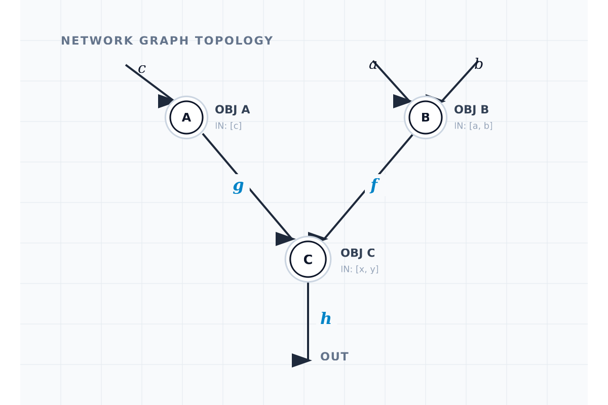

# NDL - Network Description Language

## Introduction

NDL is a language that uses mathematical categories to describe, build and simulate many types of networks, such as electronic circuits, neural networks, graphs, etc.
It allows recursion as the only iterative method, for it fits best the network modelling, than contructiong loop structures, that seems out of off the world of the language. It is not much a programming language. Its main function is to describe and them, by another machinery, build, compile and simulate the network in question. In this project Rust was chosen to take care of the programming transpilation, that can be adapted to any other programming language as well, in some of them, with certain difficulty, in others with some loss of performance (due to recursion). There are no impeadements to what the programmer can do with NDL.

### Mathematical Model - Category Theory

A category is a set of objects along with morphisms between them.

Category theory can be seem as the algebra of functions, for this reason it describes lambda calculus very easily, and lambda notation is used in NDL.

## The Language NDL

A NDL describes the network as composed of nodes $A,B,C,...$, functions $ f,g,h...$, and the network N *insieme*.
 

```haskell
Node A {
    in: c;
    out: g = (c) => (c); 
}

Node B {
    in: a,b;
    out:f = (a,b) => (a*b);
}

Node C{
    in: x,y;
    out: h = (x,y) => (x+y);
}

FUNC{
    def x,y;
    g = (x) => (x);
    f = (x,y) => (x*y);
    h = (x,y) => (x+y);
}

NET {
    g: A => C;
    f: B => C;
    h: C => OUTPUT;
}
```

Here is the formal grammar for NDL

```ebnf

-- Entry point of the grammar
entrypoints Program ;

-- Program: list of top-level declarations
Prog. Program ::= [Decl] ;

DeclNode. Decl ::= NodeDecl ;
DeclNet.  Decl ::= NetDecl ;
DeclFunc. Decl ::= FuncDecl ;

terminator Decl "" ;

-- Node Declaration
NodeD. NodeDecl ::= "node" Ident "{" NodeBody "}" ;

NodeB. NodeBody ::= NodeIn NodeOut NodeTrans ;

NodeInNone.  NodeIn ::= ;
NodeInSome.  NodeIn ::= "in:" [Ident] ";" ;

NodeOutNone. NodeOut ::= ;
NodeOutSome. NodeOut ::= "out:" [Ident] ";" ;

NodeTransNone. NodeTrans ::= ;
NodeTransSome. NodeTrans ::= Transform ";" ;

separator nonempty Ident "," ;

-- Network Declaration
NetD. NetDecl ::= "NET" "{" [NetStmt] "}" ;

NetNode.   NetStmt ::= "node" [Ident] ;
NetConn.   NetStmt ::= Connection ;
NetReturn. NetStmt ::= OutputStmt ;

terminator NetStmt ";" ;

-- Connections & Output
ConnDirect. Connection ::= Ident "->" Ident ;
ConnCast.   Connection ::= Ident "->" "(" Ident ")" Ident ;

OutStmt.    OutputStmt ::= Ident "->" "return" ;

-- Function Declaration
FuncD. FuncDecl ::= "FUNC" "{" [ExprStmt] "}" ;

EStmt. ExprStmt ::= Expr ;
terminator ExprStmt ";" ;

-- Transform
Trans. Transform ::= Ident "(" [Ident] ")" "=>" Expr ;

-- Expressions with Precedence
EAdd. Expr  ::= Expr  "+" Expr1 ;
ESub. Expr  ::= Expr  "-" Expr1 ;
EMul. Expr1 ::= Expr1 "*" Expr2 ;
EDiv. Expr1 ::= Expr1 "/" Expr2 ;

EIdent.  Expr2 ::= Ident ;
EInt.    Expr2 ::= Integer ;

coercions Expr 2 ;
```

## Architecture for the engine implementation

```
[ NDL Source Text ]
            │
            ▼
      Lexer / Parser
            │
            ▼
   Abstract Syntax Tree (AST)
            │
      Symbol Resolver & Port Binding
            │
            ▼
     Intermediate Graph IR (Adjacency / Topological Sort)
       ┌────┴──────────────────────────┐
       ▼                               ▼
[ Tree-Walk Interpreter ]      [ Native / Bytecode Compiler ]
- Dynamic evaluation queue       - Emits LLVM IR, C, or VM bytecode
- Fast iterative prototyping     - Inlined functions, zero-copy buffers
```